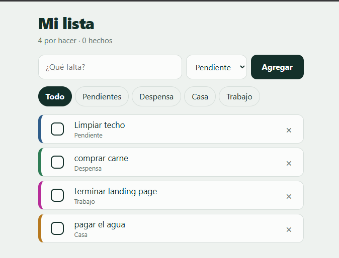

# Checkit

Lista de pendientes y compras (despensa, casa y lo que tú quieras) que **funciona sin conexión** y se instala en el celular como una app. Sin cuentas, sin servidor, sin dependencias: solo HTML, CSS y JavaScript.

## Características

- Agrega elementos con una categoría (pendiente, despensa, casa, trabajo…).
- Márcalos como hechos (se tachan con resaltador) o bórralos.
- Filtra por categoría; la app recuerda el último filtro.
- Borra todos los completados de un toque.
- Funciona **sin internet** gracias a un service worker.
- Se instala en Android e iPhone como una app (PWA).
- Tus datos se guardan en tu dispositivo (`localStorage`); no se envían a ningún sitio.
  

## Cómo usarla

### Probarla en tu computadora

El modo sin conexión necesita `localhost` o HTTPS, así que abre la carpeta con un servidor local:

```bash
python -m http.server 8000
```

Luego entra a `http://localhost:8000`.

### Publicarla gratis con GitHub Pages

1. Sube los archivos a un repositorio.
2. En el repositorio ve a **Settings → Pages**.
3. En *Build and deployment* elige **Deploy from a branch**, la rama `main` y la carpeta `/ (root)`.
4. Espera un minuto: tu app quedará en `https://TU-USUARIO.github.io/NOMBRE-DEL-REPO/`.

### Instalarla en el celular

1. Abre la dirección en el celular **una vez con internet**.
2. **Android (Chrome):** menú ⋮ → *Instalar app* o *Agregar a pantalla de inicio*.
3. **iPhone (Safari):** botón Compartir → *Agregar a pantalla de inicio*.
4. Listo: ya abre aunque estés sin conexión.

## Estructura del proyecto

| Archivo | Para qué sirve |
| --- | --- |
| `index.html` | Estructura de la página |
| `style.css` | Estilos y colores |
| `app.js` | Lógica: guardar, cargar y dibujar la lista |
| `manifest.json` | Datos para instalarla como app (nombre, íconos, colores) |
| `sw.js` | Service worker: guarda los archivos para uso sin conexión |
| `icon-192.png`, `icon-512.png` | Íconos de la app |

## Cómo agregar más categorías

Las categorías aparecen en cuatro lugares. Como ejemplo, agregamos `farmacia`.

**1. `index.html`: en el selector y en los filtros**

```html
<!-- dentro del <select id="tipo"> -->
<option value="farmacia">Farmacia</option>

<!-- dentro del <nav id="filtros"> -->
<button type="button" data-filtro="farmacia" aria-pressed="false">Farmacia</button>
```

**2. `app.js`: el objeto de nombres**

```js
const NOMBRES_TIPO = {
  pendiente: "Pendiente",
  despensa: "Despensa",
  casa: "Casa",
  farmacia: "Farmacia",
};
```

Este objeto también valida el filtro guardado, así que la categoría nueva debe estar aquí.

**3. `style.css`: el color de la categoría**

```css
:root { --c-farmacia: #8a3f7a; }
.item[data-tipo="farmacia"] { --color-tipo: var(--c-farmacia); }
```

Sin este paso funciona igual, pero la barra de color de la izquierda sale gris.

**4. `sw.js`: sube la versión del caché**

```js
const CACHE = "mi-lista-v2"; // antes v1
```

Si no lo haces, los dispositivos que ya visitaron la app seguirán mostrando la versión anterior. Hazlo **cada vez que cambies** `index.html`, `style.css` o `app.js`.

> **Ojo al renombrar:** cambiar solo el texto visible (`"Casa"` → `"Hogar"`) es seguro. Cambiar la **clave interna** (`casa` → `hogar`) deja huérfanos los elementos ya guardados con la clave vieja, porque `localStorage` los conserva como `"casa"`.

Para quitar una categoría, borra sus líneas en los mismos cuatro lugares. Los elementos que ya tengan esa categoría seguirán guardados, pero no podrás filtrarlos.

## Notas

- **Los datos viven solo en ese navegador y dispositivo.** No se sincronizan entre aparatos, y si borras los datos del sitio se pierde la lista.
- Si el navegador sigue mostrando una versión vieja: sube la versión en `sw.js` y recarga una o dos veces. En el celular, cierra la app por completo y ábrela de nuevo con internet.
- Para desarrollar, en DevTools → *Application* → *Service Workers* activa **Update on reload**.

## Licencia

MIT. Úsala, modifícala y compártela libremente.
